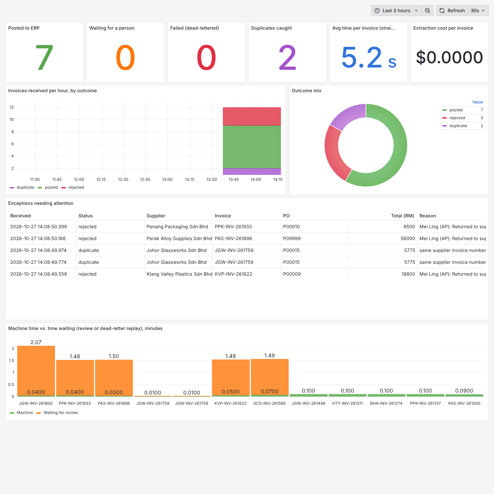
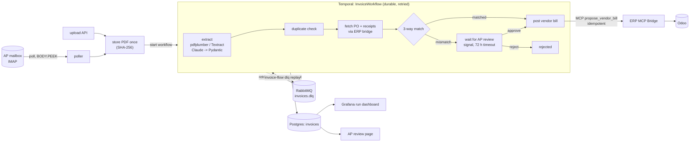
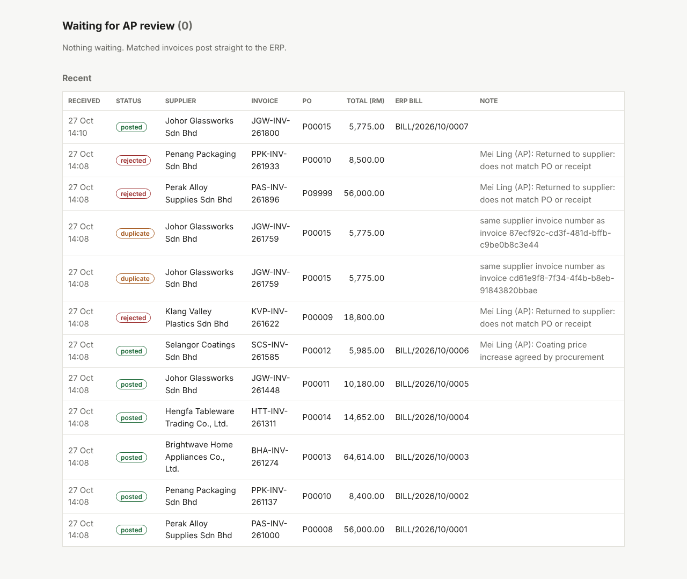

# Invoice Flow

[](https://github.com/OWNER/invoice-flow/actions/workflows/ci.yml)
 

**The problem.** Accounts payable at a manufacturer re-keys every supplier invoice from an email PDF into the ERP, after checking it against the purchase order and what the warehouse actually received. This repo automates that: it watches the AP mailbox, extracts each invoice into a strict schema, runs the 3-way match, posts matched invoices to the ERP, and sends everything else to a person with the reason already worked out.

> Part of a three-repo showcase for **Tembusu Housewares**, a fictional Malaysian housewares manufacturer and retailer. Vendor bills are posted through [erp-mcp-bridge](../erp-mcp-bridge); see also [ops-copilot-agent](../ops-copilot-agent).



## Architecture



**Steps and what happens when each fails**

| Step | Retries | On permanent failure |
|---|---|---|
| Extract text (pdfplumber; Textract or Claude vision for scans) | — | unreadable → dead-letter |
| Extract fields: Claude Haiku 5.5 with a strict Pydantic schema; if the output fails validation or doesn't add up, Claude Opus 5.5 retries once with the errors | API errors retried 6× with backoff | still invalid → dead-letter |
| Duplicate check (same supplier + invoice number) | DB retried | — marks `duplicate`, nothing posted |
| Fetch PO and receipts through the ERP bridge | 6× (2 s → 1 min) | bridge down → dead-letter, replay later |
| 3-way match (pure function, runs inside the workflow) | — | mismatch → human queue |
| Wait for a reviewer (Temporal signal) | — | 72 h timeout → dead-letter |
| Post vendor bill (bridge `propose_vendor_bill`, auto-approved by policy for this service account) | 6×, idempotent | refused → dead-letter |

## The 3-way match

Implements the receiving SOP from the company documents:

- **Quantity**: invoiced ≤ received − already billed (partial deliveries bill only what arrived).
- **Price**: within 2% of the PO price *or* RM 50 on the line, whichever is lower.
- **Tax**: SST follows the PO line (raw materials exempt, traded goods 10%).
- **Totals**: lines + tax within RM 1.00; invoice arithmetic checked line by line.
- **Lines** are matched by SKU when printed, otherwise by description similarity to the PO product.

## Demo run (this stack, seeded ERP)

`scripts/generate_invoices.py` reads the open purchase orders from the ERP and renders supplier invoices in three different layouts, covering what AP sees every week:

| Scenario | Outcome | What the reviewer saw |
|---|---|---|
| 5 clean invoices (incl. a partly received PO, and imported goods with SST) | **posted** straight through, BILL/2026/10/0001–0005 | — |
| Coating invoiced 5% above PO price | waiting → **approved** ("price increase agreed") → posted | `unit price 39.90 vs PO 38.00 (+5.0%)` |
| Resin billed for 1,000 kg, only 800 kg received | waiting → **rejected** | `invoiced 1000 but only 800 received and not yet billed` |
| Invoice quoting a PO that doesn't exist | waiting → **rejected** (approve is disabled without a PO) | `purchase order P09999 not found` |
| Total RM 100 more than lines + tax | waiting → **rejected** | `subtotal 8400.00 + tax 0.00 != total 8500.00` |
| Same invoice e-mailed twice | one processed, the other **duplicate** | — |
| Bridge taken offline mid-run | retries exhausted → **dead-letter queue** → bridge back → `dlq replay` → posted | — |



## Before vs after

| | Manual (estimate) | Automated (measured on this stack) |
|---|---|---|
| Matched invoice | ~12 min: save PDF (1), find PO and receipt in Odoo (3), key header and lines (5), check totals and SST (2), file (1) | **~6 s** machine time, no person involved (median 5.8 s over 6 straight-through invoices) |
| Invoice with a problem | ~20 min: the above plus working out what's wrong | reviewer gets the specific mismatch; decision is one click (~1–2 min, estimate) |
| Duplicate invoice | caught only if someone remembers | caught automatically |
| Supplier e-mails while the ERP is down | waits in someone's inbox | retried, dead-lettered, replayed; nothing lost |

The manual figures are a stated estimate for a typical AP clerk, not a measurement. The automated figures were measured with the offline rules extractor; with Claude extraction add the model's latency (a few seconds per invoice) and an estimated **~$0.001 per invoice** on Haiku 5.5 (about 3k input and 1k output tokens) (more when Opus 5.5 has to retry). Cost per invoice shows on the dashboard.

## Run it

```bash
git clone .../erp-mcp-bridge ../erp-mcp-bridge   # this stack includes the bridge's compose file
cp .env.example .env                               # set ANTHROPIC_API_KEY, or EXTRACTOR=rules for the offline demo
docker compose up -d
docker compose --profile demo run --rm send-demo-invoices   # e-mails the demo invoices to the AP mailbox
```

| What | Where |
|---|---|
| AP review queue | http://localhost:8200/review |
| Grafana run dashboard | http://localhost:3000 |
| Temporal UI (every workflow, step by step) | http://localhost:8233 |
| RabbitMQ (dead-letter queue) | http://localhost:15672 (guest / guest) |
| Invoice API | http://localhost:8200/docs |

Operate the dead-letter queue:

```bash
docker compose exec invoice-worker invoice-flow dlq list
docker compose exec invoice-worker invoice-flow dlq replay
```

## Tests

```bash
pip install -e ".[dev]"
pytest -q
```

28 tests: the 3-way match rules; extraction from real PDFs in all three supplier layouts; the cheap → strong model fallback; and the workflow end to end on a real Temporal server — straight-through posting, human approve/reject, duplicates (including two copies arriving at the same instant), a dropped response after the ERP write (retried without a second bill), bridge refusal → dead-letter, replay, and the 72-hour review timeout (CI uses Temporal's time-skipping server, so that one runs in seconds).

## Design notes

- **Lossless ingestion.** Emails are read with `BODY.PEEK` and flagged seen only after every PDF is stored and its workflow started. Identical files are stored once (SHA-256) and get exactly one workflow.
- **Idempotent ERP writes.** The bill is proposed with the supplier invoice number as idempotency key, and the bridge looks for an existing bill before creating one. Temporal can retry `post_bill` as often as it likes.
- **Machine time vs. waiting time.** The workflow records processing time excluding the time a person took to decide, so the dashboard shows both honestly.
- **Why Temporal, not Celery.** A run can wait three days for a reviewer, survive a worker restart in the middle, and resume exactly where it was. That's the workflow engine's job, not a task queue's.

## What I'd do next

- Approval thresholds by value (above RM 50,000 needs the Finance Controller, per the purchasing policy).
- Supplier-specific extraction hints learned from corrections in the review queue.
- E-invoicing (MyInvois) ingestion alongside e-mail.
- Alerting on dead-letter growth and review-queue age.

---

Built by [Your Name], Backend Engineer at Devs Core — [devs-core.com](https://devs-core.com). MIT licence. All company, supplier and customer names are fictional.
